# Performance baseline

This page records one hardware-rendered Apple M5 comparison captured on 22
August 2026 in Chrome 150 at 1440 x 900. It is not a minimum hardware
specification and should not be used to predict performance on untested systems.
The original capture artifacts are not included here, so this page records
results rather than defining a runnable benchmark.

## 2026-11-01: sharpness presets on an RTX 3070

The Display → PERFORMANCE presets now set sharpness as well as cost: each one
sizes the drawing buffer in device pixels, sets the globe's screen-space error
and tile cache, caps the base map's anisotropic filtering and sets the
photoreal tileset's detail (the table under "Performance presets" in
docs/CURRENT-STATE.md). This capture measures what that costs on the desktop
GPU the work targets, against main (the presets as they shipped in #4) in the
same session, and shows the sharpness in 100% crops.

| Setting | Value |
| --- | --- |
| Renderer | ANGLE Direct3D 11 on an NVIDIA GeForce RTX 3070, headless Chrome 156. Two GPUs are present; without `--force_high_performance_gpu` (which `--gpu` now passes) headless Chrome renders on the Intel UHD Graphics 770 |
| Viewport | 1600 x 900 at device pixel ratio 1, and 1600 x 900 CSS pixels at DPR 2 for the HiDPI rows |
| Scene sample | 8 seconds of scripted motion, then 8 seconds at rest |
| Population | synthetic: 2,000 aircraft, 6,000 vessels, 4,000 cameras around San Francisco, Los Angeles and Las Vegas; flat synthetic OSM tiles |
| Builds | main at 94aaace9 and this branch, each preset in a fresh page, run alternately (this branch, then main) and repeated twice at DPR 1 |
| Machine | no game running; other worktrees' dev servers and a full unit-test run shared the CPU, which read 42-100% busy at the start of a run |

`node scripts/qa-perf-presets.mjs --gpu --presets <preset> --window 8000`
(add `--dpr 2 --scenes idle,layers` for the HiDPI rows) against each build's
dev server. On a hardware GPU the frame bracket the harness times
(`preUpdate` → `postRender`) is main-thread work; the GPU's own time shows up
only as a lower frame rate.

### DPR 1 (this machine's 1600 x 900 screen)

Mean of the two runs; ± is half the spread when the runs differ by 5 fps or
more.

| Preset | Scene | Build | fps, motion / rest | Frame ms mean, motion / rest | Buffer, MSAA, FXAA |
| --- | --- | --- | ---: | ---: | --- |
| Quality | Idle globe | main | 59.8 / on demand | 3.60 / – | 1600 x 900, 4x, off |
| Quality | Idle globe | this branch | 58.8 / on demand | 6.01 / – | 1600 x 900, 4x, off |
| Quality | Flights + Vessels + CCTV | main | 42.6 (±6.9) / 45.2 | 16.18 / 16.18 | 1600 x 900, 4x, off |
| Quality | Flights + Vessels + CCTV | this branch | 37.8 / 41.1 | 19.02 / 17.88 | 1600 x 900, 4x, off |
| Quality | Cockpit | main | 22.6 / 28.6 | 35.95 / 27.77 | 1600 x 900, 4x, off |
| Quality | Cockpit | this branch | 23.0 / 22.8 | 34.06 / 35.30 | 1600 x 900, 4x, off |
| Balanced (default) | Idle globe | main | 59.7 / on demand | 3.46 / – | 1600 x 900, 2x, off |
| Balanced (default) | Idle globe | this branch | 59.3 / on demand | 4.42 / – | 1600 x 900, 2x, off |
| Balanced (default) | Flights + Vessels + CCTV | main | 40.1 / 44.8 | 16.55 / 16.62 | 1600 x 900, 2x, off |
| Balanced (default) | Flights + Vessels + CCTV | this branch | 45.8 (±8.6) / 52.4 | 14.35 / 12.84 | 1600 x 900, 2x, off |
| Balanced (default) | Cockpit | main | 25.0 / 26.4 | 33.28 / 30.52 | 1600 x 900, 2x, off |
| Balanced (default) | Cockpit | this branch | 43.2 (±14.2) / 41.0 | 19.60 / 21.26 | 1600 x 900, 2x, off |
| Performance | Idle globe | main | 30.0 / on demand | 3.50 / – | 1200 x 675, 1x, on |
| Performance | Idle globe | this branch | 29.9 / on demand | 3.83 / – | 1200 x 675, 1x, on |
| Performance | Flights + Vessels + CCTV | main | 29.4 / 29.8 | 14.50 / 14.37 | 1200 x 675, 1x, on |
| Performance | Flights + Vessels + CCTV | this branch | 29.5 / 29.8 | 14.43 / 14.00 | 1200 x 675, 1x, on |
| Performance | Cockpit | main | 28.3 / 29.3 | 20.96 / 19.26 | 1200 x 675, 1x, on |
| Performance | Cockpit | this branch | 28.4 / 28.8 | 21.20 / 19.48 | 1200 x 675, 1x, on |

The cockpit rows are a real Cockpit entry this time (Contacts context with
Flights and Military on). "On demand" is idle mode: a parked scene renders
nothing until something changes.

What the table shows, and what it does not:

- At DPR 1 Quality and Balanced draw the same 1600 x 900 buffer on both
  builds, so the cost of the sharpness work is the finer globe. The idle
  globe in motion is the clean comparison: Quality's main-thread frame rises
  from 3.6 to 6.0 ms (the globe refines a level deeper at screen-space error
  1, so there are more tiles to select and draw) and Balanced's from 3.5 to
  4.4 ms (error 1.5); both still hold the 60 fps cap. Performance keeps
  Cesium's globe defaults and is unchanged within noise.
- The layer and cockpit scenes are main-thread bound by the live layers, and
  the shared CPU moved them by 5-15 fps between repetitions. Read their
  differences as noise: nothing in this change touches layer work, and the
  same build swung by up to 28 fps between runs.
- Performance holds its 30 fps cap in every scene on both builds.

### DPR 2 (HiDPI), one run each

| Preset | Scene | Build | fps, motion / rest | Frame ms mean, motion / rest | Buffer, MSAA, FXAA |
| --- | --- | --- | ---: | ---: | --- |
| Quality | Idle globe | main | 59.9 / on demand | 3.99 / – | 1600 x 900, 4x, off |
| Quality | Idle globe | this branch | 58.3 / on demand | 7.57 / – | 3200 x 1800, 4x, off |
| Quality | Flights + Vessels + CCTV | main | 31.4 / 34.8 | 21.59 / 20.18 | 1600 x 900, 4x, off |
| Quality | Flights + Vessels + CCTV | this branch | 30.7 / 35.5 | 22.91 / 19.73 | 3200 x 1800, 4x, off |
| Balanced (default) | Idle globe | main | 60.0 / on demand | 3.82 / – | 1600 x 900, 2x, off |
| Balanced (default) | Idle globe | this branch | 59.9 / on demand | 4.96 / – | 2400 x 1350, 2x, off |
| Balanced (default) | Flights + Vessels + CCTV | main | 32.1 / 36.1 | 20.81 / 19.16 | 1600 x 900, 2x, off |
| Balanced (default) | Flights + Vessels + CCTV | this branch | 34.0 / 43.5 | 20.29 / 16.29 | 2400 x 1350, 2x, off |

On a HiDPI screen main drew CSS pixels and let the browser double them; this
branch draws every device pixel in Quality (four times the pixels, at 4x
MSAA) and 1.5 per CSS pixel in Balanced. The RTX 3070 absorbs that: the
frame rate is unchanged within noise and the idle globe still holds 60 fps.
A weaker GPU will not; Performance (one device pixel per CSS pixel at DPR 2,
FXAA) is the setting for it.

### Sharpness, in 100% crops

`node scripts/qa-sharpness-crops.mjs --gpu --url <dev server> --label <build>`
against both builds, Balanced and Quality, on the keyless globe (Esri World
Imagery on Re:Earth terrain; the worktrees had no map keys, so the photoreal
tileset's finer error in Quality is not in these images). UI hidden, every
layer off, captured once the globe reported every tile loaded. Each crop is
cut at device resolution around 50% / 40% of the viewport.

- San Francisco: 650 m over the Embarcadero, heading 235°, pitch −32°,
  looking into the Financial District.
- Las Vegas: 1,300 m (about 680 m above the valley floor) over the south end
  of the Strip, heading 0°, pitch −32°.

DPR 1, 320 x 200 pixels:

| View | Preset | main | this branch |
| --- | --- | --- | --- |
| San Francisco | Balanced | 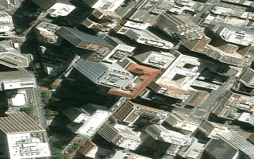 |  |
| San Francisco | Quality | 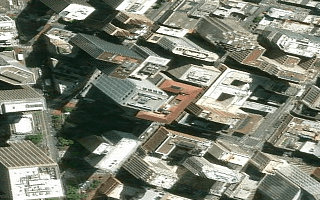 | 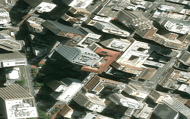 |
| Las Vegas | Balanced |  | 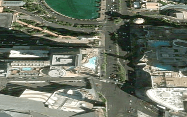 |
| Las Vegas | Quality | 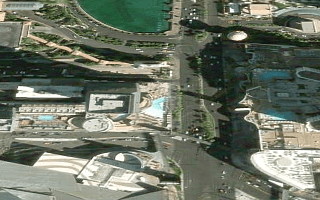 | 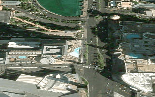 |

DPR 2, 200 x 125 CSS pixels (400 x 250 device pixels):

| View | Preset | main | this branch |
| --- | --- | --- | --- |
| San Francisco | Balanced | 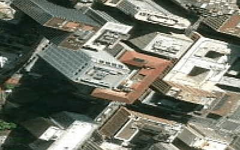 |  |
| San Francisco | Quality | 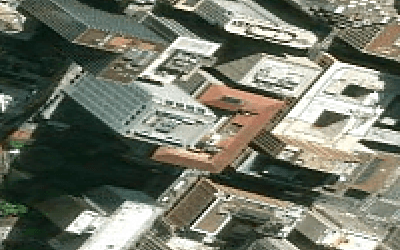 |  |
| Las Vegas | Balanced | 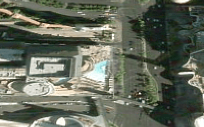 | 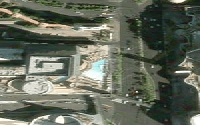 |
| Las Vegas | Quality |  | 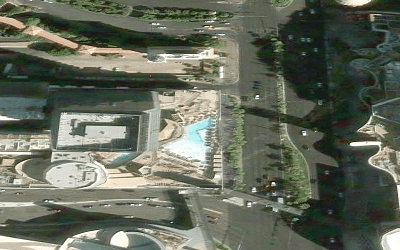 |

Fine detail in each crop, as the mean squared Laplacian of its grey levels
(higher is more fine detail; it also counts stair-steps and sharpen halos, so
read it with the images):

| Crop | Balanced, main → this branch | Quality, main → this branch |
| --- | ---: | ---: |
| San Francisco, DPR 1 | 10,326 → 10,336 (+0.1%) | 10,321 → 10,354 (+0.3%) |
| Las Vegas, DPR 1 | 4,104 → 4,228 (+3%) | 4,089 → 4,297 (+5%) |
| San Francisco, DPR 2 | 3,835 → 4,141 (+8%) | 3,833 → 12,569 (+228%) |
| Las Vegas, DPR 2 | 1,781 → 1,412 (−21%) | 1,782 → 2,441 (+37%) |

At DPR 1 the buffer is the same on both builds, so the change is finer
imagery: small in the middle of the frame, larger toward the horizon. Over
the full Las Vegas frames, the farther ground in the top third (60-340 px from
the top) gains 14-29% detail in both presets. At DPR 2 the
gain is the buffer itself: Quality's every-pixel buffer is visibly sharper
than main's doubled one. Balanced at DPR 2 trades main's doubled buffer for a
1.5x one; its edges are smoother and less stair-stepped, which this measure
reads as less detail in Las Vegas.

## 2026-11-01: pick-render removal and Performance presets

A second capture, taken while adding the Display → PERFORMANCE presets, in
the headless Chromium this repository's QA scripts use. It is a
software-rendered (SwiftShader) run, so its absolute numbers are far below any
desktop GPU and must not be compared with the M5 tables below; read the ratios.
Under SwiftShader the GPU work happens inside the frame bracket the harness
measures (`preUpdate` → `postRender`), so "frame ms" is the whole-frame cost
and the frame rate follows it. The capture is repeatable:
`node scripts/qa-perf-presets.mjs` against a running dev server, with
`--profile` to attribute a slow window and `--trace-readpixels` to name the
code issuing GPU read-backs. Pass `--gpu` on a desktop to measure a real
renderer with the same scenes.

| Setting | Value |
| --- | --- |
| Renderer | ANGLE Vulkan on SwiftShader (software), headless Chromium 1243 |
| Viewport | 1600 x 900 at device pixel ratio 1 |
| Scene sample | 8 seconds of scripted motion (a slow pan with a heading sweep), then 8 seconds at rest |
| Population | synthetic: 2,000 aircraft, 6,000 vessels, 4,000 cameras around San Francisco, Los Angeles and Las Vegas; OSM-style flat tiles |
| Camera | 1,800 m over downtown San Francisco, heading 25°, pitch −38° |

### What the profile showed

With Flights, AIS vessels and CCTV on, a CPU profile of the layers scene put
97% of the main thread's samples inside `readPixels`, reached through
`drillPickFromRay`, that is `scene.sampleHeight`. The caller was the aircraft
ground snap for grounded 3D-modeled planes (`src/services/groundSnap.js`):
one sample per plane, four per 250 ms window, each a full offscreen pick
render of the scene plus a synchronous read-back. 690 read-backs were issued in
one 20-second window. On a desktop GPU the same call re-renders the scene and
stalls the pipeline on every sample; SwiftShader only makes the cost visible.

The ground snap, the mesh-floor cell sampler and the camera ground guard now
read the rendered surface through `scene.getHeight`
(`src/services/surfaceHeight.js`), a CPU ray test against loaded terrain and
every tileset with `enableCollision`, which the photoreal globe has.

| Scene (Flights + Vessels + CCTV) | Frame cost, motion / rest | GPU read-backs |
| --- | ---: | ---: |
| Before | 15,127 ms / 15,595 ms | 690 in 20 s |
| After the surface-height change | 220 ms / 182 ms | 0 from the layers |

### Presets

| Preset | Scene | Frames in 8 s, motion / rest | Frame ms mean, motion / rest | Buffer, MSAA, FXAA |
| --- | --- | ---: | ---: | --- |
| Default build before the preset row | Idle globe, no layers | 7 / 6 | 172.8 / 449.25 | 1600x900, 2x, off |
| Default build before the preset row | Flights + Vessels + CCTV | 7 / 7 | 64.01 / 213.91 | 1600x900, 2x, off |
| Default build before the preset row | Tracked flight (cockpit entry gated, see below) | 8 / 7 | 198.84 / 228.13 | 1600x900, 2x, off |
| Quality | Idle globe, no layers | 12 / 9 | 180.47 / 413.73 | 1600x900, 4x, off |
| Quality | Flights + Vessels + CCTV | 8 / 7 | 47.17 / 210.14 | 1600x900, 4x, off |
| Quality | Tracked flight (cockpit entry gated, see below) | 7 / 8 | 213.09 / 69.63 | 1600x900, 4x, off |
| Balanced (default) | Idle globe, no layers | 11 / 12 | 141.85 / 158.15 | 1600x900, 2x, off |
| Balanced (default) | Flights + Vessels + CCTV | 8 / 7 | 48.47 / 207.43 | 1600x900, 2x, off |
| Balanced (default) | Tracked flight (cockpit entry gated, see below) | 8 / 8 | 68.33 / 200.5 | 1600x900, 2x, off |
| Performance | Idle globe, no layers | 15 / 9 | 82.66 / 46.6 | 1200x675, 1x, on |
| Performance | Flights + Vessels + CCTV | 9 / 9 | 44.92 / 148.2 | 1200x675, 1x, on |
| Performance | Tracked flight (cockpit entry gated, see below) | 10 / 8 | 74.85 / 279.89 | 1200x675, 1x, on |

The first block is the fixed build with no preset selected, so it is the
reference for the three preset blocks beneath it. The cockpit rows are a
tracked flight over the same layers: the harness could not pass the cockpit
entry gate (Contacts context with Flights and Military on) in this capture, so
they measure the tracked-entity follow camera, not the cockpit itself. The
"Before" row for Flights + Vessels + CCTV in the table above this one is the
unmodified tree.

Quality is the previous behavior (full resolution, 4× MSAA, 60 fps, Dense @
75). Balanced, the new default, is Quality at 2× MSAA. Performance renders
at three-quarter resolution with FXAA instead of MSAA, caps the continuous
loop at 30 fps, turns the sharpen pass off, solves Sparse @ 25, doubles the
live layers' re-evaluation intervals, halves the traffic dot budget and
raises the photoreal tileset's screen-space error to 24 with a 768 MiB cache.
Idle mode is unchanged by the frame-rate cap: a parked scene renders on
demand only, so the idle rows differ by noise.

### Still to capture

- The same three scenes on the RTX 3070 desktop with the game running on the
  other screen. Without it they are in "sharpness presets on an RTX 3070"
  above, on a CPU other work was sharing.
- Street traffic: the road source was unreachable from the capture
  environment, so the traffic dot budget change is unmeasured here.

## Test context

The baseline was captured on 22 August 2026 with these conditions:

| Setting | Value |
| --- | --- |
| Renderer | Apple M5 Metal through the hardware ANGLE path |
| Browser | Chrome 150 in a fresh isolated profile |
| Viewport | 1440 x 900 at device pixel ratio 1 |
| Focus | Page foregrounded for controlled scenes |
| Scene sample | 5 seconds of scripted motion, then 5 seconds at rest |
| Startup | Browser cache disabled; three samples |

The capture covered three startup samples, 16 cold layer scenarios with 14
measurements, 23 controlled option and stress scenes, and five
hardware-rendered overlay scenes.

## Startup

| Sample | App ready | Initial settle | Load event | Motion / rest | Used JS heap |
| ---: | ---: | ---: | ---: | ---: | ---: |
| 1 | 784.980 ms | 2,035.082 ms | 439.5 ms | 60 / 60 FPS | 102.9 MiB |
| 2 | 604.849 ms | 1,855.836 ms | 442.4 ms | 60 / 60 FPS | 111.6 MiB |
| 3 | 558.527 ms | 1,809.592 ms | 438.8 ms | 60 / 60 FPS | 105.1 MiB |
| Median | 604.849 ms | 1,855.836 ms | 439.5 ms | 60 / 60 FPS | 105.1 MiB |

The initial-settle measurement is the more useful launch reference because it
includes the first visual and data settling window. All three samples reached
the display ceiling during both motion and rest.

## Cold layer activation

Cold activation was measured separately from warm option switching. Live object
counts are included so that future runs can compare source populations before
attributing a difference to the client.

| Layer | Activation | Source count | Motion / rest | Used JS heap |
| --- | ---: | ---: | ---: | ---: |
| CCTV city | 19,608.240 ms | 48 | 60 / 60 FPS | 192.7 MiB |
| Space Missions (report label: Rocket missions) | 3,581.066 ms | 26 | 60 / 60 FPS | 131.3 MiB |
| Radio | 3,458.709 ms | 750 | 60 / 60 FPS | 124.8 MiB |
| Bikeshare | 2,069.498 ms | 633 | 60 / 60 FPS | 157.4 MiB |
| Datacenters | 817.693 ms | 4,362 | 59.6 / 60 FPS | 328.2 MiB |
| Flights | 667.671 ms | 247 | 60 / 60 FPS | 118.4 MiB |
| Submarine cables | 614.727 ms | 2,629 | 60 / 60 FPS | 412.0 MiB |
| Military Flights | 557.113 ms | 68 | 60 / 60 FPS | 118.4 MiB |

CCTV had the largest cold activation cost in this capture. Submarine cables
used the most heap, followed by datacenters. Completed single-layer samples
generally reached 60 FPS, so activation time and heap separate these cases more
clearly than steady-state frame rate.

## Aircraft, detection, and Cockpit

| Scene | Motion / rest |
| --- | ---: |
| Idle globe | 60 / 60 FPS |
| Flights, 2D | 60 / 60 FPS |
| Flights, 3D proximity | 60 / 60 FPS |
| Flights, all 3D models | 60 / 60 FPS |
| Military Flights, all 3D models | 60 / 60 FPS |
| Detection at 25% | 39.3 / 41.1 FPS |
| Detection at 50% | 37.4 / 39.8 FPS |
| Detection at 100% | 34.4 / 35.5 FPS |
| Cockpit | 49.6 / 49.2 FPS |

The clean detection scenes processed 8,169 to 8,170 observations. Selected
labels rose from 14 at 25% density to 28 at 50% and 56 at 100%. The aircraft
rows came from an earlier loaded, foreground-controlled pass because the clean
rerun received no live aircraft rows.

## Visual styles and combined stress

| Scene | Motion / rest |
| --- | ---: |
| Normal | 60 / 60 FPS |
| CRT (report label: Retro) | 60 / 60 FPS |
| NVG (report label: Surveillance) | 60 / 60 FPS |
| FLIR (report label: Thermal) | 49 / 60 FPS |
| Anime | 60 / 59.8 FPS |
| Noir | 47 / 56.6 FPS |
| Snow | 42.3 / 45.8 FPS |
| Combined static | 57.6 / 60 FPS |
| Combined operational | 39.9 / 43.1 FPS |

The combined static scene rendered 11,575 objects, used 872.2 MiB of JavaScript
heap, and issued 48,665 text draws during motion and 54,106 at rest. The combined
operational sample contained 3,909 observations and two selected labels, but its
live aircraft and traffic rows were empty, so it remains a limited stress case.

Snow, Noir, dense detection, and text-heavy combined layers are the clearest
controlled comparison points for later optimization work. Snow has since been
retired as a visual preset; its row records the measurement as taken.

## Keyed live sources

NASA FIRMS, AISStream, and TomTom were captured in a separate hardware-rendered
pass. The page was visible but was not the focused window, so these frame rates
must not be compared directly with the foreground-controlled scenes above.

| Source | Point-in-time population | Activation or coverage | Motion / rest |
| --- | ---: | --- | ---: |
| NASA FIRMS | 100,430 detections in 3,557 cells | 30.0 s activation | 32.1 / 55.2 FPS |
| AISStream | 12,000 vessels | 6.4 s activation | 22.1 / 29.8 FPS |
| TomTom Traffic | 4,222 road dots | 70% coverage, 2 decoded tiles | 45.0 / 51.7 FPS |

These populations change continuously. A future comparison must record the
live counts again and match the focus conditions.

## Controls for a future capture

Use the same controls before attributing a difference to the application:

1. Record the exact GPU renderer and reject software-rendered or unavailable GPU
   strings.
2. Use a 1440 x 900 viewport at device pixel ratio 1 and keep the page focused.
3. Measure cache-disabled startup separately from cold layer activation and warm
   option switching.
4. Repeat startup three times and compare medians.
5. Sample each option for 5 seconds in scripted motion and 5 seconds at rest.
6. Record live object counts before attributing a difference to the client.
7. Treat a live-source outage as missing coverage, not as evidence of low client
   rendering cost.
8. Record whether the app is running in Pinokio's embedded view or in an
   external browser. One Pinokio 8.2.0 user reported severe stutter in the
   embedded view that went away when the same local URL was opened in a normal
   browser ([#365](https://github.com/bilawalsidhu/gods-eye-view/issues/365)).
   Do not compare embedded-view and external-browser measurements directly;
   compare the reported GPU renderer and matched scene settings first.

## What is not established yet

- This report does not establish Windows performance.
- The report does not record machine memory capacity, so it cannot support a
  minimum-memory recommendation.
- The report does not cover other GPU renderers or viewport configurations.
- Military Installations is outside this comparison because it requires close
  camera context.
- The keyed pass has no controlled rerun suitable for comparison with the
  option scenes.

Use this page as a regression baseline for one known hardware and browser
configuration, not as a compatibility guarantee.
